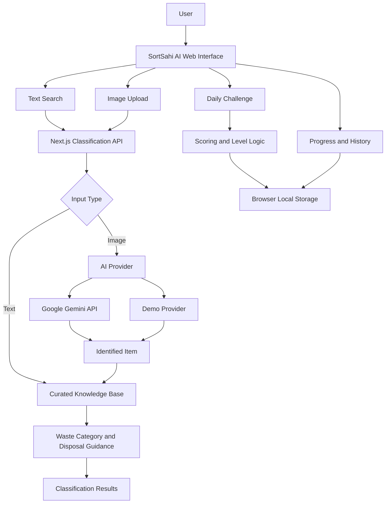
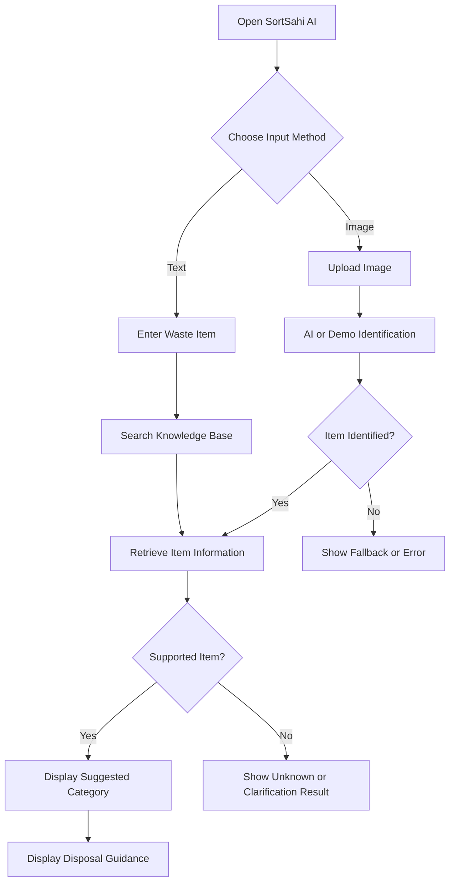

# ♻️ SortSahi AI
### Identify it. Sort it right.

**An AI-powered waste identification and segregation learning platform.**

| Project Details | Information |
|---|---|
| Project Name | SortSahi AI |
| Team Name | ASAP |
| Hackathon | WeMakeDevs Environmental Hacks 2026 |
| Track | Track 03 — Waste and Energy |
| Application Type | Responsive Web Application |
| AI Provider | Google Gemini (optional live AI integration) |

---

## 🌱 About the Project

SortSahi AI helps people identify everyday waste, understand waste segregation, and learn appropriate disposal practices through an interactive web application.

People often struggle to determine whether an item belongs in wet waste, dry waste, sanitary waste, or a special-care waste stream. Incorrect segregation can contaminate recyclable materials and lead to inappropriate disposal.

SortSahi AI aims to make waste segregation simpler by combining a curated waste knowledge base, AI-assisted image identification, disposal guidance, and gamified environmental education.

**Our mission is to make responsible waste segregation easier, smarter, and more engaging for everyone.**

## 🎯 Problem Statement

Incorrect waste segregation is a common environmental challenge.

- Recyclable materials can become contaminated by food and other waste.
- Organic waste may be mixed with non-biodegradable materials.
- Batteries and electronic waste may be disposed of incorrectly.
- People often lack clear information about appropriate disposal methods.
- Traditional awareness campaigns do not always provide guidance when a person needs to make a disposal decision.

SortSahi AI addresses this challenge by providing accessible information at the point of disposal.

## 💡 Our Solution

SortSahi AI provides a simple platform where users can search for waste items or upload an image to explore their suggested category and disposal guidance.

The application combines knowledge-based classification with optional AI-assisted image identification. It also encourages environmental learning through daily quizzes, GreenScore points, levels, and progress tracking.

## ✨ Key Features

### 🔍 1. Smart Waste Classification
- Search for waste items by name.
- Match supported items against a curated knowledge base.
- View suggested waste categories and disposal guidance.
- Handle unknown items without automatically assigning an unsupported classification.

### 📸 2. AI-Assisted Image Identification
- Upload an image of a waste item.
- Use Google Gemini for image identification when live AI is configured.
- Process identified items through the application's classification logic.
- Support a demo or fallback mode, depending on the configured provider.

*Live AI image identification requires a valid Gemini API key and a supported model.*

### ♻️ 3. Waste Segregation Categories

| Category | Examples |
|---|---|
| Wet Waste | Fruit peels, vegetable scraps, kitchen waste |
| Dry Waste | Clean paper, glass, metal, recyclable packaging |
| Sanitary Waste | Sanitary products and diapers |
| Special-Care Waste | Batteries, electronic waste, and certain chemicals |

Actual disposal requirements may vary by item condition and local waste-collection rules.

### 🧠 4. Daily Environmental Challenges
- Educational waste-segregation questions.
- Multiple-choice answers and feedback.
- Explanations to improve environmental awareness.
- GreenScore rewards for eligible learning activities.

### 🌿 5. GreenScore and Levels
- Earn points through eligible activities.
- Track progress toward higher levels.
- Explore a five-level progression system.
- Encourage consistent participation in environmental learning.

### 📊 6. Learning History
- View recorded learning activities.
- Track points and progress.
- Review the current level.
- Store progress locally in the browser.

### 📱 7. Responsive User Interface
- Mobile-friendly and desktop-friendly layouts.
- Dedicated classification, challenge, and history pages.
- Reusable React components.
- Simple navigation for a smooth user experience.

---

## 🏗️ System Architecture

SortSahi AI uses a Next.js application architecture. The frontend and classification API route are included in the same application.



### Architecture Components

**Frontend:** Next.js, React, TypeScript, and Tailwind CSS provide the user interface.

**Classification API:** A Next.js API route processes classification requests and coordinates the configured classification provider.

**AI Integration:** Google Gemini can identify items from images when valid credentials and a supported model are configured.

**Knowledge Base:** A curated collection of waste items provides supported classifications and disposal guidance.

**Learning Engine:** Challenge and scoring logic supports quizzes, points, levels, and progress tracking.

**Storage:** Browser `localStorage` stores progress locally without requiring a separate database.

**Deployment:** AWS Amplify configuration is included for the intended hosting workflow.

## 🔄 Application Workflow



### Daily Challenge Workflow

1. The user opens the daily challenge.
2. The application displays an educational question.
3. The user selects an answer.
4. The application provides feedback and an explanation.
5. Eligible correct answers earn GreenScore points.
6. The scoring logic checks reward eligibility.
7. Progress is saved in browser storage.

---

## 🛠️ Technology Stack

| Technology | Purpose |
|---|---|
| Next.js 14 | Application framework, routing, and API routes |
| React 18 | User interface components |
| TypeScript | Type-safe application development |
| Tailwind CSS 3 | Responsive styling |
| Google Gemini API | Optional AI-assisted image identification |
| Curated Knowledge Base | Waste-item classification and disposal guidance |
| Browser localStorage | Local progress persistence |
| Lucide React | Icons |
| Node.js | JavaScript runtime |
| npm | Dependency management |
| ESLint | Code-quality checks |
| AWS Amplify | Intended hosting and deployment |

### Why These Technologies?

- **Next.js:** Combines application pages and server-side API functionality in one project.
- **React:** Supports reusable, interactive user-interface components.
- **TypeScript:** Improves code organization and helps catch type-related errors.
- **Google Gemini:** Provides an AI-assisted approach to identifying waste items from images.
- **Knowledge-based classification:** Separates item identification from curated disposal guidance.
- **localStorage:** Enables lightweight local progress tracking without a database.
- **AWS Amplify:** Provides a potential deployment path for the application.

---

## 📂 Project Structure

The main application is contained in the `sortsahi-app` directory.

```text
sortsahi-app/
├── src/
│   ├── app/
│   │   ├── api/
│   │   │   └── classify/
│   │   │       └── route.ts
│   │   ├── classify/
│   │   ├── challenge/
│   │   ├── history/
│   │   ├── layout.tsx
│   │   ├── page.tsx
│   │   ├── loading.tsx
│   │   └── not-found.tsx
│   ├── components/
│   ├── features/
│   ├── lib/
│   │   ├── ai/
│   │   ├── data/
│   │   ├── classification.ts
│   │   ├── scoring.ts
│   │   └── utils.ts
│   └── types/
├── docs/
├── .env.example
├── .gitignore
├── amplify.yml
├── next.config.mjs
├── tailwind.config.ts
├── package.json
└── README.md
```

This is a logical overview of the project structure. Refer to the actual repository for the complete list of source files.

---

## 🚀 Getting Started

### Prerequisites

- Node.js compatible with Next.js 14.
- npm.
- Git (if cloning the repository).
- An optional Google Gemini API key for live AI functionality.

### 1. Clone the Repository

Replace the example URL with your actual GitHub repository URL.

```bash
git clone https://github.com/YOUR_USERNAME/sortsahi-ai.git
cd sortsahi-ai
cd sortsahi-app
```

If the repository itself contains the Next.js application at its root, skip the second `cd` command.

### 2. Install Dependencies

```bash
npm install
```

### 3. Configure Environment Variables

Create a `.env.local` file in the Next.js application directory.

```env
GEMINI_API_KEY=your_own_gemini_api_key
GEMINI_MODEL=your_supported_gemini_model
```

Use a model identifier supported by the application's implementation and available to your Google AI account.

**Security guidelines:**
- Never commit `.env.local` to GitHub.
- Never expose the API key in frontend code.
- Use your own authorized API credentials.
- If a key has already been exposed, revoke it and generate a replacement.

### 4. Start the Development Server

```bash
npm run dev
```

Open:

```text
http://localhost:3000
```

### 5. Build for Production

```bash
npm run build
```

After a successful build, run:

```bash
npm run start
```

---

## ☁️ Deployment

The project includes an AWS Amplify configuration for the intended deployment workflow.

1. Push the sanitized project to GitHub.
2. Open the AWS Amplify Console.
3. Connect the GitHub repository.
4. Select the branch to deploy.
5. Configure the required environment variables.
6. Run the build and deployment.
7. Test classification, image uploads, challenges, and progress tracking.

Deployment is not considered complete until the hosted application has been deployed and verified.

---

## 🧪 Testing Checklist

Before a hackathon submission, verify the following:

- [ ] The application starts successfully.
- [ ] The production build completes.
- [ ] Text classification handles supported items.
- [ ] Unknown items are handled appropriately.
- [ ] Image identification works with valid AI credentials.
- [ ] Missing or invalid credentials produce a suitable fallback or error.
- [ ] Daily challenges display correct feedback.
- [ ] GreenScore and level progression work correctly.
- [ ] Progress persists after a browser refresh.
- [ ] The interface works on mobile and desktop.
- [ ] No API keys or other secrets are committed.
- [ ] Any deployed version is tested using its public URL.

---

## 🌍 Environmental Impact

SortSahi AI aims to improve waste-segregation awareness through accessible guidance and interactive learning.

Our intended impact pathway is:

**Better information → Better segregation decisions → Reduced recyclable contamination → More effective waste processing.**

The application supports environmental education. Actual environmental impact would need to be measured using real-world user behavior, waste-management data, and verified outcomes.

---

## ⚠️ Current Limitations

- The curated knowledge base has limited coverage and may not recognize every waste item.
- AI image identification depends on model performance, image quality, and API availability.
- Disposal guidance must be verified against local regulations.
- Browser-based progress is not synchronized between devices.
- The project does not currently provide a complete cloud account and database system.
- Real-world classification accuracy has not been established without a representative evaluation dataset.
- Hosting configuration does not by itself establish that the application has been deployed.

These limitations represent opportunities for future development.

---

## 🔮 Future Scope

- Expand the waste knowledge base.
- Evaluate image classification using a labelled dataset.
- Add multilingual support for Indian languages.
- Integrate verified, location-specific waste-disposal rules.
- Add user accounts and cloud-synchronized progress.
- Introduce persistent database storage.
- Improve accessibility and low-bandwidth support.
- Measure user engagement and environmental learning outcomes.
- Explore integrations with municipal waste-management services.

---

## 👥 Team Information

**Team Name:** ASAP  
**Project:** SortSahi AI  
**Hackathon:** WeMakeDevs Environmental Hacks 2026  
**Track:** Track 03 — Waste and Energy  

### Project Links

- **GitHub Repository:** Add your repository URL after publishing.
- **Live Demo:** Add the deployed application URL when available.
- **Demo Video:** Add the video URL when available.

---

## 📄 License

No open-source license has been confirmed for this project. Add an appropriate `LICENSE` file before granting public reuse rights.

---

## 💚 Conclusion

SortSahi AI combines waste identification, segregation guidance, and interactive learning in one accessible web application.

By helping users make better-informed disposal decisions, the project aims to encourage responsible waste-segregation habits and greater environmental awareness.

**SortSahi AI — Identify it. Sort it right.**
