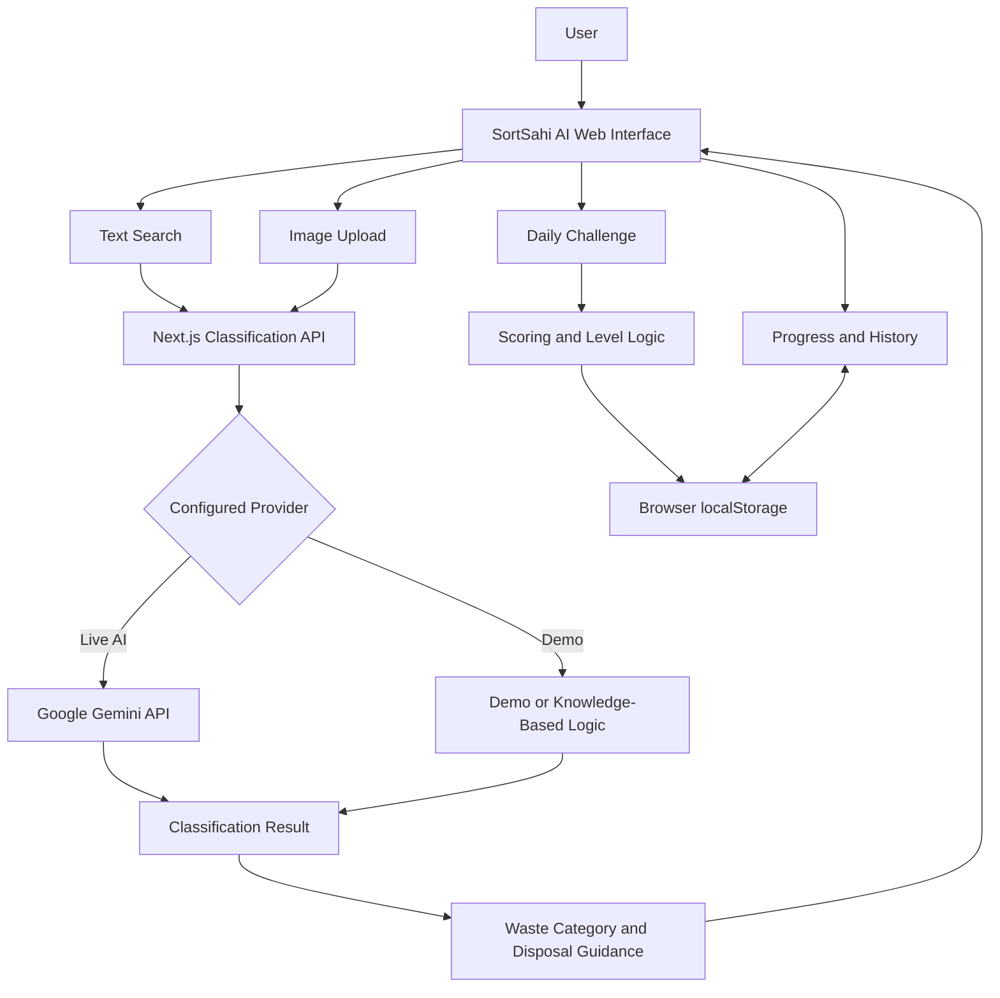
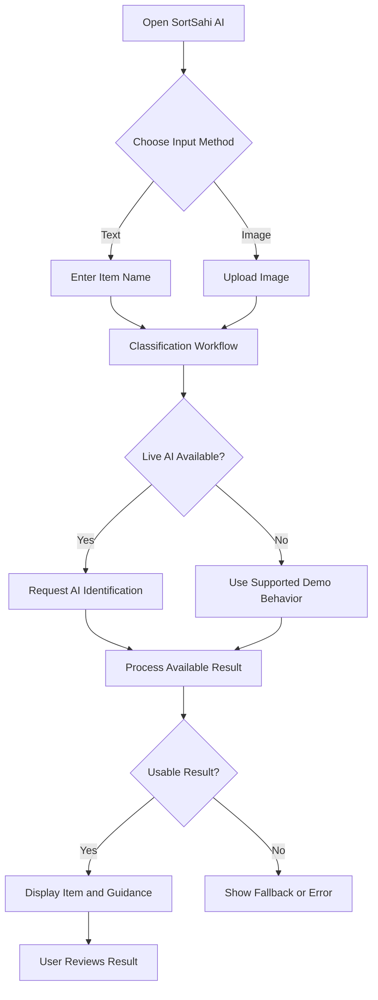

# SortSahi AI ♻️
### Identify It. Sort It Right.

**An AI-assisted waste identification, segregation, and environmental learning platform.**

<p align="center">
  
  
  
  
  
</p>

---

## Project Information

| Detail | Description |
|---|---|
| Project Name | SortSahi AI |
| Team Name | ASAP |
| Hackathon | WeMakeDevs Environmental Hacks 2026 |
| Track | Track 03 — Waste and Energy |
| Project Category | Sustainability and Artificial Intelligence |
| Application Type | Web Application |
| AI Integration | Google Gemini, when configured |
| Frontend Framework | Next.js and React |

## Overview

SortSahi AI is a web application designed to make waste segregation easier through accessible waste identification, disposal guidance, and interactive environmental education.

People often struggle to determine the correct way to dispose of everyday items. Food waste, recyclable packaging, sanitary products, batteries, and electronic waste may require different handling methods. Uncertainty about these categories can lead to incorrect segregation and contamination of recyclable materials.

SortSahi AI addresses this challenge through a combination of a curated waste knowledge base, AI-assisted image identification, contextual guidance, and gamified learning.

Users can search for waste items, upload images where supported, explore suggested disposal categories, complete daily environmental challenges, and track their learning progress.

**Our vision is to make responsible waste segregation simpler, smarter, and more engaging.**

## Problem Statement

Effective waste management starts with correct segregation at the source. However, several barriers make this difficult:

- Lack of awareness about waste categories and disposal practices.
- Confusion about whether common items are recyclable, biodegradable, or require special handling.
- Contamination of recyclable materials through incorrect segregation.
- Limited access to clear, item-specific disposal guidance.
- Difficulty maintaining engagement with environmental education.

These challenges highlight the need for an accessible tool that helps users make better-informed waste-disposal decisions.

## Our Solution

SortSahi AI provides a unified interface for waste identification and environmental learning.

The application combines text-based item lookup with optional AI-assisted image identification. Identified items can be matched with supported waste information and disposal guidance.

To encourage continued learning, the application also includes daily challenges, a GreenScore points system, level progression, and learning-history features.

The project focuses on three goals:

1. **Identify:** Help users identify common waste items.
2. **Segregate:** Provide relevant waste-category and disposal information.
3. **Educate:** Encourage better habits through interactive environmental learning.

## Key Features

### 1. Smart Waste Identification

- Search for supported waste items by name.
- Match recognized items against a curated knowledge base.
- Display suggested categories and relevant disposal guidance.
- Handle unsupported inputs without automatically treating every result as certain.

### 2. AI-Assisted Image Identification

- Upload an image of a waste item.
- Use Google Gemini when live AI functionality is configured.
- Process image-identification results through the application's classification workflow.
- Support configured demo or fallback behavior.

Live AI functionality requires a valid API key, a supported model, and working provider integration. The availability of the code does not guarantee that every AI feature has been tested.

### 3. Waste Segregation Guidance

The application organizes waste information into four broad categories.

| Category | Examples |
|---|---|
| Wet Waste | Fruit peels, vegetable scraps, organic kitchen waste |
| Dry Waste | Clean paper, glass, metal, and recyclable packaging |
| Sanitary Waste | Sanitary products and diapers |
| Special-Care Waste | Batteries, electronic waste, and selected hazardous household materials |

These categories are educational guidance. Actual disposal requirements depend on the material, its condition, and local waste-management rules.

### 4. Daily Environmental Challenges

- Educational waste-segregation questions.
- Multiple-choice answers.
- Feedback and explanations.
- GreenScore rewards for eligible learning activities.

### 5. GreenScore and Level Progression

- Earn points through supported activities.
- Track progress toward higher levels.
- Explore a five-level progression system.
- Encourage continued engagement with environmental learning.

### 6. Learning History

- Review recorded learning activities.
- Track points and progress.
- View level information.
- Persist supported progress data in browser storage.

Progress stored in `localStorage` is browser-specific and is not automatically synchronized across devices.

### 7. Responsive User Interface

- Mobile-friendly and desktop-friendly layouts.
- Dedicated classification, challenge, and history pages.
- Reusable interface components.
- Navigation centered on the application's main workflows.

## System Architecture

SortSahi AI uses a Next.js application architecture. The user interface and classification API route are part of the same application.



### Architecture Components

| Component | Responsibility |
|---|---|
| Frontend | Renders the interface and handles user interactions. |
| Next.js App Router | Organizes pages and application routes. |
| Classification API | Processes requests and invokes the configured classification workflow. |
| Gemini Integration | Supports AI-assisted identification when correctly configured. |
| Curated Knowledge Base | Provides information for supported waste items. |
| Learning Logic | Supports challenges, scoring, and level progression. |
| Browser Storage | Persists supported progress data locally. |
| AWS Amplify Configuration | Provides a potential deployment path. |

The architecture described here is for the Next.js project in this repository. A separate FastAPI backend is not assumed to be part of this application.

## Application Workflow



### Learning Workflow

1. The user opens a daily challenge.
2. The application displays a question.
3. The user selects an answer.
4. Feedback and an explanation are displayed.
5. Eligible activities update the score.
6. Reward eligibility is checked by the scoring logic.
7. Supported progress information is stored locally.

## Technology Stack

| Technology | Purpose |
|---|---|
| Next.js 14 | Web framework, routing, and API routes |
| React 18 | Component-based user interface |
| TypeScript | Type-safe application development |
| Tailwind CSS 3 | Responsive styling |
| Google Gemini API | Optional AI-assisted image identification |
| Curated Knowledge Base | Supported waste-item information and guidance |
| Browser `localStorage` | Local progress persistence |
| Lucide React | Icons |
| Node.js | JavaScript runtime |
| npm | Dependency management |
| ESLint | Code-quality checks |
| AWS Amplify | Intended hosting and deployment platform |

### Design Principles

- **Modularity:** Keep application responsibilities organized.
- **Separation of concerns:** Distinguish identification from disposal guidance wherever possible.
- **Responsible AI:** Treat AI output as fallible and avoid unsupported accuracy claims.
- **Security:** Keep API credentials out of public source code.
- **Maintainability:** Use typed code and reusable components.
- **Accessibility:** Aim for an interface usable across common screen sizes.

## Project Structure

The main Next.js application is located in the `sortsahi-app` directory.

```text
sortsahi-app/
├── src/
│   └── app/
│       ├── api/
│       │   └── classify/
│       │       └── route.ts
│       ├── classify/
│       ├── challenge/
│       ├── history/
│       ├── layout.tsx
│       ├── page.tsx
│       ├── loading.tsx
│       └── not-found.tsx
├── .env.example
├── .gitignore
├── amplify.yml
├── next.config.mjs
├── package.json
├── tailwind.config.ts
└── README.md
```

This is a high-level representation of the application structure. Refer to the actual repository for the complete list of files and directories.

## Getting Started

### Prerequisites

- Node.js compatible with the project's Next.js version.
- npm.
- Git, if cloning the repository.
- A Google AI Studio API key for live Gemini functionality.

### 1. Clone the Repository

Replace the placeholder with the actual public repository URL.

```bash
git clone https://github.com/YOUR_USERNAME/sortsahi-ai.git
cd sortsahi-ai
cd sortsahi-app
```

If the repository root already contains `package.json`, skip the final `cd sortsahi-app` command.

### 2. Install Dependencies

If `package-lock.json` is present, run:

```bash
npm ci
```

Otherwise, run:

```bash
npm install
```

### 3. Configure Environment Variables

Create a `.env.local` file in the Next.js application directory.

```env
GEMINI_API_KEY=your_own_google_ai_studio_key
GEMINI_MODEL=your_supported_gemini_model
```

Use a model identifier supported by the application's implementation and available to your Google AI account.

**Security requirements:**

- Never commit `.env.local` to GitHub.
- Never expose private API keys in client-side code.
- Use only credentials you are authorized to use.
- Revoke and replace any key that has been exposed.
- Configure deployment credentials through the hosting platform's environment settings.

### 4. Start the Development Server

```bash
npm run dev
```

Open the local URL shown in the terminal, usually:

```text
http://localhost:3000
```

### 5. Create a Production Build

```bash
npm run build
```

After a successful build, start the production server with:

```bash
npm start
```

A successful build does not, by itself, verify that live AI integration or a public deployment works correctly.

## Deployment

The repository includes an AWS Amplify configuration intended to support deployment.

1. Push the sanitized project to GitHub.
2. Open the AWS Amplify Console.
3. Connect the GitHub repository.
4. Select the deployment branch.
5. Configure required environment variables.
6. Run the build and deployment.
7. Verify classification, image uploads, challenges, and progress tracking on the deployed application.

**Deployment status:** Do not describe the application as live until a public URL has been deployed and tested.

## Testing and Verification

Before a hackathon submission or public release, verify the following:

- [ ] The application starts successfully.
- [ ] The production build completes.
- [ ] Text classification returns appropriate results for supported inputs.
- [ ] Unknown and ambiguous items are handled appropriately.
- [ ] Image identification works with valid Gemini credentials.
- [ ] Missing credentials and API failures are handled appropriately.
- [ ] Daily challenges provide the expected feedback.
- [ ] GreenScore and level progression work correctly.
- [ ] Progress persists after a browser refresh.
- [ ] The interface works on desktop and mobile.
- [ ] No private credentials or secrets are committed.
- [ ] The deployed application, if available, has been tested.

Only mark a test as complete after verifying it yourself.

## Security and Responsible AI

SortSahi AI may rely on external AI services for live classification.

- Keep API credentials server-side.
- Validate model responses before presenting them.
- Handle unavailable models, invalid credentials, and rate limits.
- Avoid presenting uncertain predictions as verified facts.
- Review special-care waste guidance against official local instructions.
- Do not claim a measured classification accuracy without a documented evaluation.
- Do not claim environmental impact measurements without supporting evidence.

## Current Limitations

- The curated knowledge base has limited coverage.
- AI identification can be incorrect, especially for unclear images or ambiguous materials.
- Disposal rules vary by location and may change.
- Browser-based progress is not synchronized across devices.
- A complete cloud account and database system is not included in the described architecture.
- Classification performance and environmental impact require separate evaluation.
- Production readiness depends on successful integration, testing, and deployment.

## Future Scope

Potential improvements include:

- Expanding waste-item and packaging coverage.
- Evaluating classification against a labelled dataset.
- Adding multilingual support for Indian languages.
- Integrating verified, location-specific disposal guidance.
- Introducing user accounts and synchronized learning progress.
- Adding persistent database storage.
- Improving accessibility and low-bandwidth usability.
- Measuring environmental learning outcomes and engagement.
- Exploring integrations with municipal waste-management services.

## Team and Hackathon

| Field | Details |
|---|---|
| Project | SortSahi AI |
| Team Name | ASAP |
| Hackathon | WeMakeDevs Environmental Hacks 2026 |
| Track | Track 03 — Waste and Energy |

### Project Links

- **Repository:** Use the URL of this GitHub repository.
- **Live Demo:** Add a verified deployment URL when available.
- **Demo Video:** Add the final demonstration URL when available.

## License

No open-source license has been confirmed for this project. Before allowing public reuse or redistribution, add a suitable `LICENSE` file and confirm that the project's dependencies and assets permit the intended use.

## Acknowledgements

- Google Gemini for optional AI-assisted image identification.
- The open-source ecosystem supporting Next.js, React, TypeScript, and Tailwind CSS.
- Environmental educators and waste-management resources that inform responsible segregation practices.

---

**SortSahi AI — Identify It. Sort It Right.**

*Using accessible technology to encourage informed waste segregation and environmental learning.*
